# Solution IA — Applications sur mesure pour les entreprises

> **Votre problème métier est unique. Votre outil devrait l'être aussi.**
> Je conçois et je développe des applications sur mesure, données, web et IA, pour résoudre des problèmes **précis** d'entreprise : là où un logiciel standard est trop lourd, trop cher ou à côté du besoin.

  
  
  

  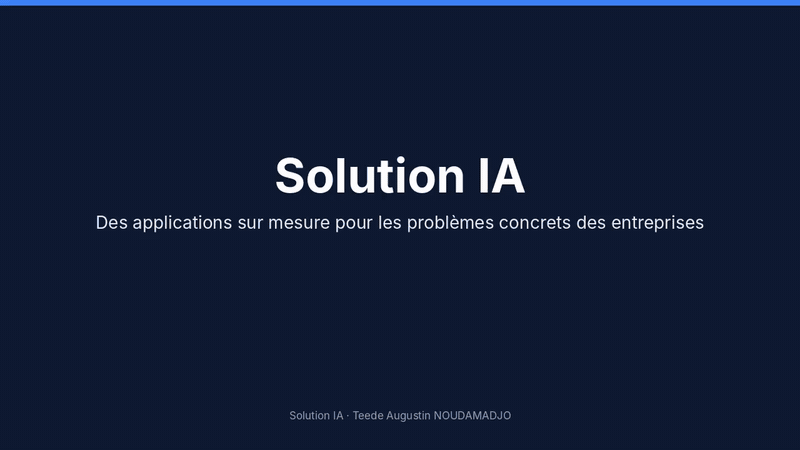

---

## Sommaire

1. [Le constat](#-le-constat)
2. [Ce que je construis](#-ce-que-je-construis)
3. [Ma méthode](#-ma-méthode)
4. [Réalisations](#-réalisations)
5. [Mes engagements](#-mes-engagements)
6. [Technologies](#-technologies)
7. [Contact](#-contact)

---

## 🎯 Le constat

Beaucoup de PME gèrent encore des processus critiques avec des **fichiers Excel envoyés par e-mail**, des copier-coller et des contrôles faits à la main. Les erreurs passent inaperçues, les décisions arrivent tard, et les logiciels du marché sont souvent **surdimensionnés** pour le besoin réel.

**Solution IA** part du problème, pas de la technologie : un outil **ciblé**, **simple à utiliser** et **fiable**, livré rapidement et amélioré avec ceux qui l'utilisent.

---

## 🧰 Ce que je construis

| Type d'application | Exemples de problèmes résolus |
|---|---|
| 📊 **Outils d'analyse de données métier** | Fiabiliser des fichiers d'achats et de ventes, calculer des marges, repérer les fournisseurs en retard |
| 🛡️ **Conformité et contrôle** | Vérifier automatiquement des dossiers réglementaires (ex. EUDR), bloquer ce qui n'est pas conforme |
| 🌐 **Plateformes web et mobiles (PWA)** | Mettre en relation citoyens, clients ou membres avec des services vérifiés |
| 🔐 **Back-offices sécurisés** | Administrer une plateforme avec double authentification et journal d'audit |
| 🤖 **Automatisation et IA** | Générer des brouillons de relance, résumer, classer, assister les équipes |
| 📈 **Tableaux de bord de pilotage** | Suivre des indicateurs fiables, chacun justifié par son mode de calcul |

---

## 🧭 Ma méthode

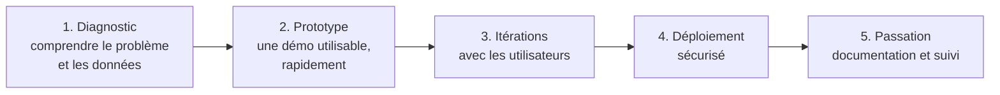

| Étape | Ce que vous obtenez |
|---|---|
| **Diagnostic** | Une reformulation claire du problème, des données disponibles et des indicateurs de réussite |
| **Prototype** | Une démo en ligne, testable avec des données fictives ou anonymisées |
| **Itérations** | Des ajustements guidés par l'usage réel, pas par des suppositions |
| **Déploiement** | Une application en ligne (HTTPS), avec la sécurité et le RGPD intégrés dès le départ |
| **Passation** | Une documentation complète, pour que l'outil vive même sans moi |

---

## 📂 Réalisations

### 1. Analyse achats supply chain : du fichier CSV brut au plan d'action fournisseurs

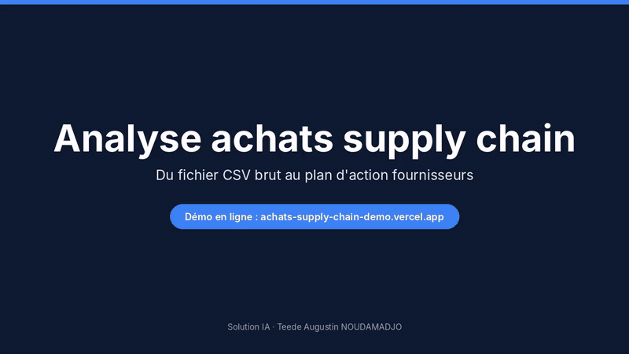

  
  

| | |
|---|---|
| **Problème** | Des exports d'achats et de ventes hétérogènes, analysés à la main : erreurs silencieuses, marges inconnues, fournisseurs en retard non relancés. |
| **Solution** | Une application qui lit les fichiers déposés, reconnaît les colonnes, écarte et explique les lignes invalides, calcule les indicateurs clés, classe les produits (ABC) et prépare les relances fournisseurs. |
| **Points forts** | Chaque chiffre est justifié · règles explicites (ex. relance si moins de 80 % de livraisons à l'heure sur au moins 5 commandes) · **les données ne quittent jamais le navigateur** · aucun e-mail envoyé sans validation humaine |

<table><tr>
<td>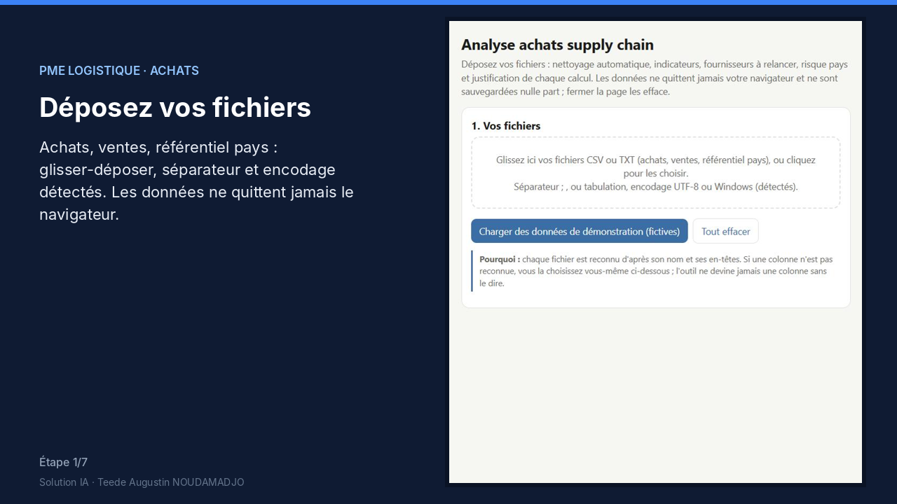</td>
<td>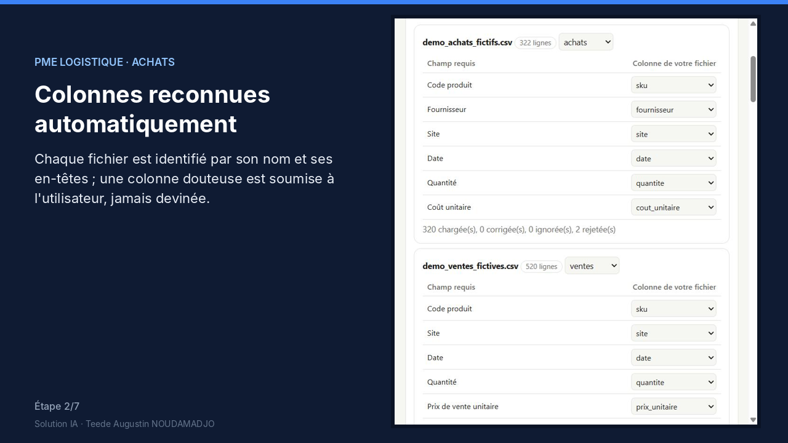</td>
<td>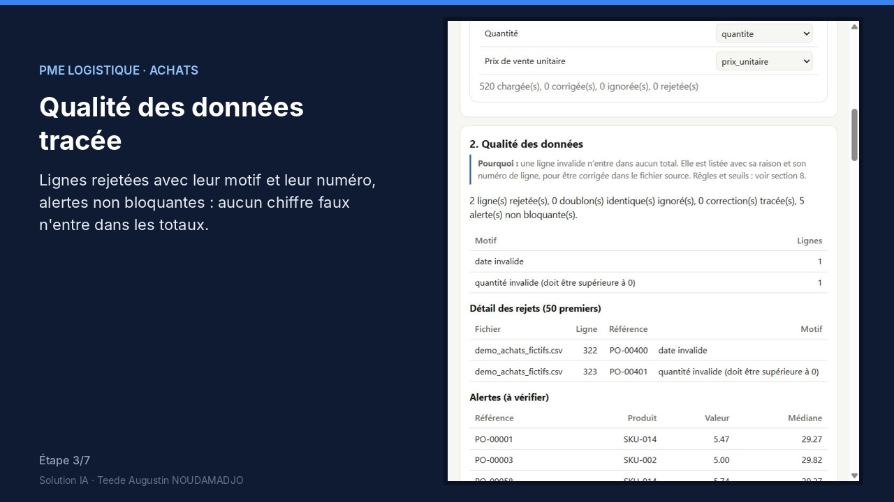</td>
</tr></table>

---

### 2. Santé Bénin : urgences, pharmacies de garde et praticiens vérifiés

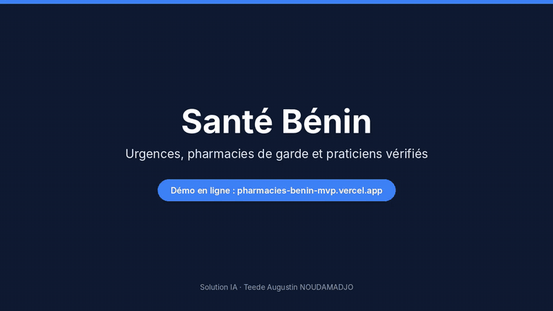

  
  

| | |
|---|---|
| **Problème** | Trouver rapidement une pharmacie de garde ou un professionnel de santé fiable, et se protéger des faux praticiens. |
| **Solution** | Une plateforme couvrant les 12 départements et 77 communes : urgences et bouton SOS, pharmacies et établissements filtrables, vérification des praticiens, signalement, téléconsultation et espace cabinet. |
| **Points forts** | Praticiens visibles seulement après contrôle de leur inscription à l'Ordre · **back-office avec double authentification (TOTP)** et journal d'audit de chaque tentative · interface mobile d'abord |

<table><tr>
<td>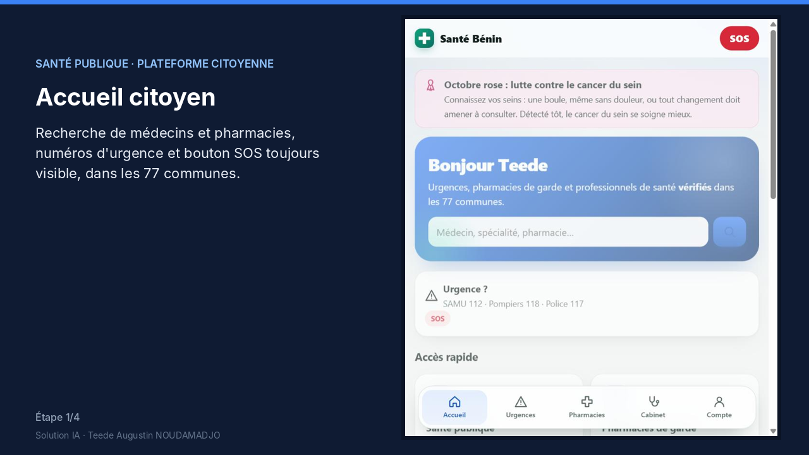</td>
<td>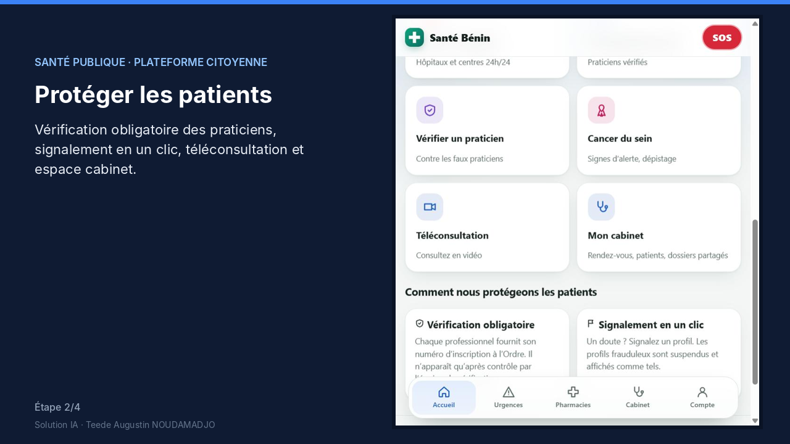</td>
<td>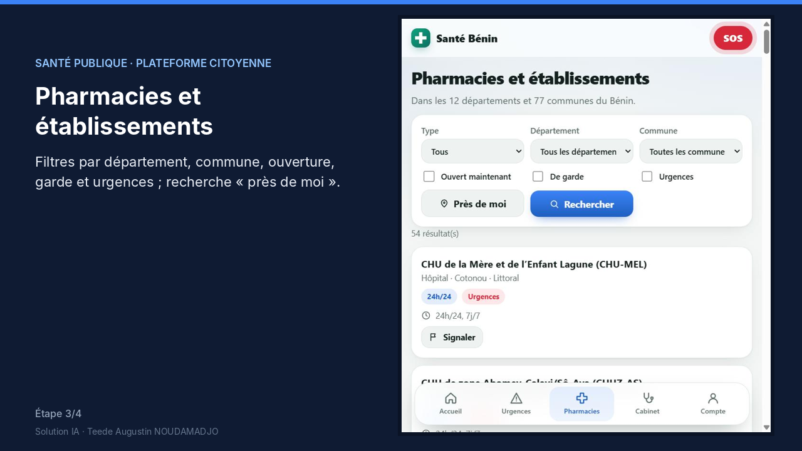</td>
</tr></table>

---

### 3. Tracea : conformité EUDR et diligence raisonnée des parcelles

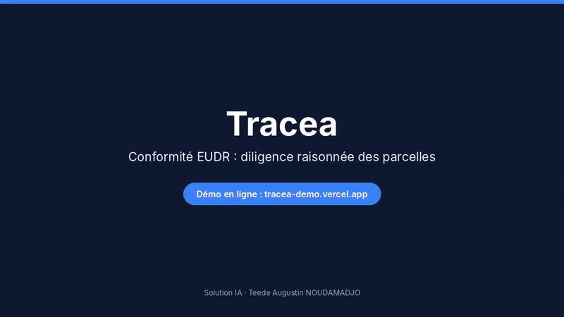

  
  

| | |
|---|---|
| **Problème** | Le règlement européen contre la déforestation (EUDR) impose de prouver l'origine de chaque lot ; vérifier les parcelles à la main est long et risqué. |
| **Solution** | Une analyse automatique de chaque parcelle d'un lot (risque, anomalies, chevauchements) et un verdict clair : lot conforme ou bloqué. |
| **Points forts** | Contrôles géométriques (GPS manquant, polygone qui se croise, écart entre surface déclarée et calculée) · détection des chevauchements · producteurs absents du registre signalés · démo avec indicateurs simulés, clairement indiqués comme tels |

<table><tr>
<td>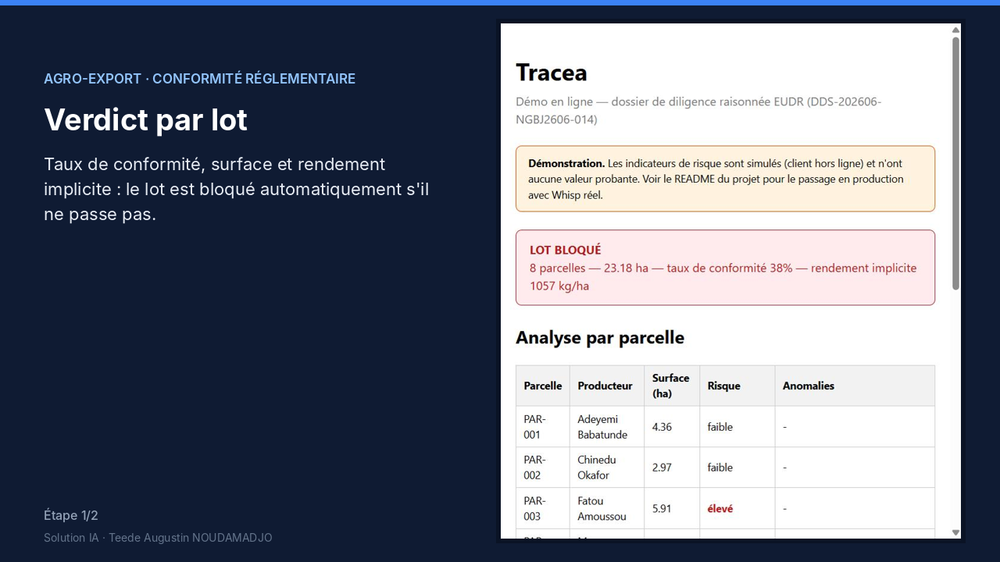</td>
<td>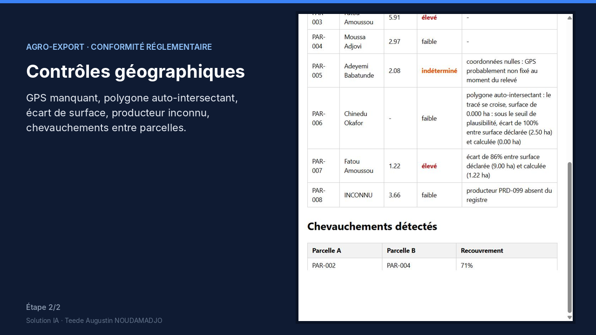</td>
</tr></table>

---

### Et aussi

| Projet | En bref |
|---|---|
| [**Teedaïk**](https://github.com/Teede-N/teedaik-showcase) | Réseau social francophone et actualités IA, en production, avec une sécurité de niveau professionnel |
| [**RetentIA**](https://github.com/Teede-N/retentia-churn-dataiku) | Prédire et expliquer le départ des clients (churn) : statistiques et machine learning |
| [**AfrIA**](https://github.com/Teede-N/afrique-ia) | Plateforme gratuite d'apprentissage de l'IA, 53 modules, 4 langues |
| [**IA·Classroom**](https://github.com/Teede-N/ia-classroom) | Masterclass IA & No-Code, 40 modules et certification |

---

## ✅ Mes engagements

| Engagement | En pratique |
|---|---|
| **Fiabilité** | Chaque indicateur est expliqué ; une donnée invalide est écartée et signalée, jamais intégrée en silence |
| **Sécurité** | Double authentification, mots de passe en Argon2id, journal d'audit, en-têtes HTTP de sécurité |
| **Données personnelles (RGPD)** | Minimisation des données ; traitement local dans le navigateur quand c'est possible |
| **Contrôle humain** | L'outil propose, l'utilisateur décide : aucun envoi ou blocage irréversible sans validation |
| **Transmission** | Documentation complète et passation, pour que l'outil reste maintenable |

---

## 🛠️ Technologies

`Python` `SQL` `pandas` `scikit-learn` · `Next.js` `React` `TypeScript` `JavaScript` · `PostgreSQL` `Vercel` · `PWA` · `Power BI` · `Dataiku DSS`

Le choix de la technologie suit le besoin : un outil 100 % navigateur quand les données doivent rester chez le client, une plateforme complète quand il faut des comptes et une base de données.

---

## 📫 Contact

**Teede Augustin NOUDAMADJO**, fondateur de Solution IA · Data Scientist Junior
Licence de mathématiques (École normale supérieure, Bénin) · Master Big Data & IA (ESTIAM Lyon)

✉️ [teedeaugustinnoudamadjo41@gmail.com](mailto:teedeaugustinnoudamadjo41@gmail.com?subject=Projet%20Solution%20IA) · 💼 [LinkedIn](https://www.linkedin.com/in/teede-noudamadjo)

> 💬 Décrivez votre problème en quelques lignes : je vous réponds avec une première analyse et une proposition de prototype.
